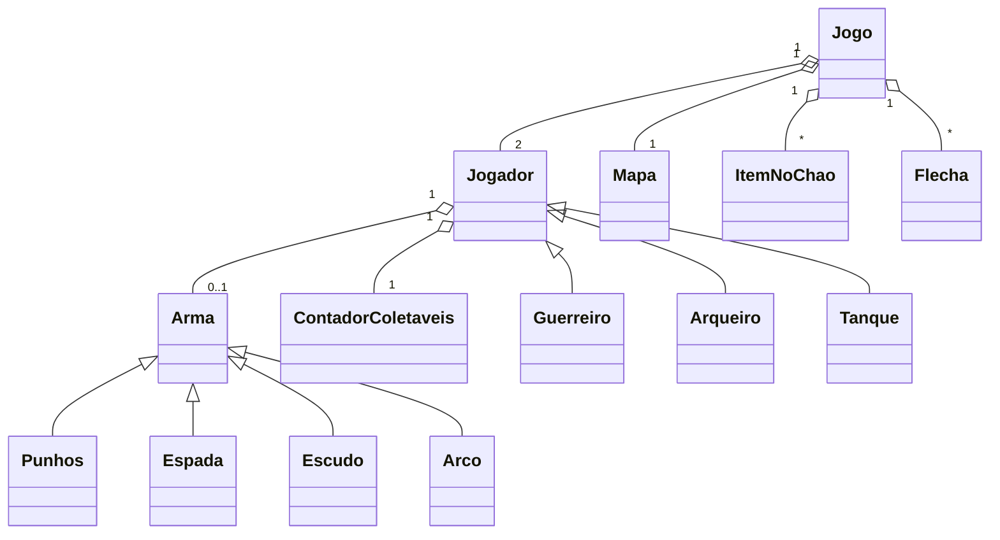

# AssaCin's Creed

Projeto da disciplina de **Introdução à Programação — CIn/UFPE (2026.2)**.

> Este README é o **relatório do projeto** (o enunciado permite entregar o relatório aqui em vez de PDF).
> Trechos em _itálico_ ainda precisam ser preenchidos. Trechos marcados com **(planejado)** descrevem o que ainda será implementado e devem ser atualizados no fim.

---

## 🎯 Sobre o projeto

**AssaCin's Creed** é um duelo local em 2D, visto de cima, para dois jogadores no mesmo teclado. Em uma arena com obstáculos, assassinos encapuzados lutam em uma **melhor de 3 rodadas**. Antes da partida, cada jogador escolhe uma classe (Guerreiro, Arqueiro ou Tanque), que define vida, velocidade e em qual arma recebe bônus.

As armas (espada, escudo e arco) e os itens (corações, bônus de velocidade e poção) **surgem espalhados pela arena**, e cada jogador **move seu personagem para coletá-los**. Sem arma, luta-se com os punhos. Há um único botão de ação por jogador: um toque faz um ataque normal e segurar o botão carrega um ataque pesado.

**Objetivo do jogador:** vencer 2 rodadas, zerando a vida do oponente, usando bem as armas e os itens coletados.

### Requisitos mínimos (obrigatórios)
- [ ] Sistema interativo em ambiente **2D** — _duelo em arena 2D vista de cima, feito com Pygame._
- [ ] O usuário **controla um objeto** para coletar outros objetos na tela — _cada jogador controla um personagem que coleta armas e itens._
- [ ] No mínimo **três tipos distintos de coletáveis** — _coração vermelho, coração verde, bônus de velocidade e poção (4 tipos); as armas também são coletáveis._
- [ ] Registro da **quantidade coletada de cada tipo**, exibida ao usuário — _contador por jogador e por tipo, mostrado na interface **(planejado)**._
- [ ] Código estruturado com **Orientação a Objetos**.
- [ ] Desenvolvido exclusivamente em **Python**.

> ⚠️ Implementem primeiro os requisitos mínimos. Só depois os extras.

---

## 👥 Equipe

| Nome | GitHub | E-mail / login CIn |
|---|---|---|
| Tiago Leal | Sttoch | tlbs |
| Pedro Arthur | pacszin | pacs |
| Davi Ferro | dcf-dev | dcf |
| Ryan Medeiros | ryanmedeirosp | rmp4 |
| Daniel Barros | dsbl2 | dsbl2 |
| Lucas Rangel | lucasnobre903 | lrn2 |

---

## ▶️ Como executar

1. Ter o **Python 3** instalado.
2. Clonar o repositório:
   ```bash
   git clone https://github.com/Ryanmedeirosp/Projeto-IP-CinUFPE.git
   cd Projeto-IP-CinUFPE
   ```
3. (Opcional) Criar e ativar um ambiente virtual:
   ```bash
   python -m venv .venv
   .venv\Scripts\activate      # Windows
   source .venv/bin/activate   # Linux / Mac
   ```
4. Instalar as dependências:
   ```bash
   pip install -r requirements.txt
   ```
5. Rodar o jogo:
   ```bash
   python main.py
   ```

### Controles
| Tecla | Ação |
|---|---|
| W A S D | Mover o jogador 1 |
| Setas | Mover o jogador 2 |
| _Tecla de ação (jogador 1)_ | _A definir._ Toque: ataque normal ou pegar arma. Segurar: ataque pesado. Com escudo: aparar |
| _Tecla de ação (jogador 2)_ | _A definir_ (mesma função) |
| _Teclas de escolha de classe_ | _A definir_ (3 por jogador, uma por classe) |
| ESC | _Sair (a definir: pausar)_ |
| F1 | Mostrar caixas de colisão e estados (depuração) **(planejado)** |

---

## 📸 Capturas de tela

_Adicionar aqui os prints do jogo funcionando (ficam em [`docs/screenshots/`](docs/screenshots/)). Eles também vão para a galeria de projetos._

<!-- Exemplo:

-->

---

## 🏗️ Arquitetura do projeto

Todo o código é escrito seguindo a PEP 8. Os nomes que vêm do Python e do Pygame continuam em inglês.

### Estrutura proposta **(planejado)**

A estrutura de pastas veio de outro projeto e serve só de ponto de partida. Esta é a proposta baseada no GDD; ela será ajustada na divisão de tarefas.

```txt
Projeto-IP-CinUFPE/
├── assets/                  # arquivos externos (sem código)
│   ├── images/              # sprites, fundo, ícones
│   ├── sounds/              # efeitos sonoros
│   ├── music/               # músicas de fundo
│   └── fonts/               # fontes da interface e dos menus
├── classes/                 # classes do jogo (Orientação a Objetos)
│   ├── jogo.py              # laço principal, rodadas e regras da partida
│   ├── jogador.py           # personagem controlado (movimento, estado, vida)
│   ├── guerreiro.py         # classe Guerreiro
│   ├── arqueiro.py          # classe Arqueiro
│   ├── tanque.py            # classe Tanque
│   ├── arma.py              # classe base das armas
│   ├── punhos.py            # sem arma
│   ├── espada.py            # espada
│   ├── escudo.py            # escudo (bloqueio e aparada)
│   ├── arco.py              # arco
│   ├── ataque.py            # dados de um ataque (dano, atordoamento, ...)
│   ├── flecha.py            # flechas (normal, saraivada, potente, refletida)
│   ├── item_no_chao.py      # armas e itens coletáveis no mapa
│   ├── mapa.py              # obstáculos, pontos de surgimento
│   ├── temporizador.py      # cronômetro baseado em dt
│   ├── contador_coletaveis.py  # quantidade coletada de cada tipo
│   └── interface.py         # barras de vida, contadores e mensagens
├── utils/                   # funções auxiliares
│   ├── colisao.py           # colisões (círculos, arcos, linhas)
│   ├── aplicar_golpe.py     # matriz de defesa em um só lugar
│   └── carregador_assets.py # carregamento de imagens, sons e fontes
├── testes/                  # testes simples (asserts)
├── docs/                    # documentação (checkpoints, tarefas, apresentação, prints)
├── configuracao.py          # todos os números do jogo
├── main.py                  # ponto de entrada
├── requirements.txt         # dependências
└── README.md                # este relatório
```

Cada pasta tem um `README.md` e cada arquivo `.py` começa com um comentário explicando o que deve ser implementado nele.

### Diagrama de classes **(planejado)**



_Ajustar o diagrama quando a hierarquia final for decidida (por exemplo, se as classes viram subclasses de `Jogador` ou apenas dados de configuração)._

---

## 🧰 Ferramentas, bibliotecas e frameworks

| Ferramenta | Para que foi usada | Por que escolhemos |
|---|---|---|
| Python 3 | Linguagem do projeto | Obrigatória na disciplina |
| Pygame | Janela, desenho 2D, teclado, colisões e (opcionalmente) sons | Biblioteca de jogos 2D em Python, adequada ao nível da disciplina e com muita documentação |
| Git / GitHub | Versionamento e entrega | Uso obrigatório; permite trabalhar em seis pessoas com um branch por funcionalidade (ver [`docs/fluxo_git.md`](docs/fluxo_git.md)) |
| _Trello / Notion / GitHub Projects_ | _Gerenciar tarefas_ | _..._ |
| _Discord / WhatsApp_ | _Comunicação do grupo_ | _..._ |

---

## 🧑‍🤝‍🧑 Divisão de trabalho

_Quem fez o quê. Detalhes em [`docs/divisao_tarefas.md`](docs/divisao_tarefas.md)._

| Integrante | Contribuições |
|---|---|
| Tiago Leal | _..._ |
| Pedro Arthur | _..._ |
| Davi Ferro | _..._ |
| Ryan Medeiros | _..._ |
| Daniel Barros | _..._ |
| Lucas Rangel | _..._ |

---

## 📚 Conceitos da disciplina utilizados

_Os locais abaixo são planejados. Atualizar com os arquivos e classes reais no fim do projeto._

| Conceito | Onde foi usado |
|---|---|
| Classes e objetos | `Jogador`, `Arma`, `Flecha`, `Mapa` |
| Herança | `Espada(Arma)`, `Arco(Arma)`, `Guerreiro(Jogador)` |
| Polimorfismo | `ao_soltar()` e `atualizar(dt)` em cada arma; só o `Escudo` sobrescreve `ao_apertar()` |
| Encapsulamento | `Vida` e `ContadorColetaveis` (valores alterados só por métodos) |
| Laços de repetição | Laço principal do jogo em `Jogo.executar()` |
| Condicionais | Regras de colisão, bloqueio, aparada e fim de rodada |
| Listas | Itens no chão, flechas, obstáculos |
| Dicionários | Contadores por tipo de coletável, teclas de cada jogador |
| Funções | `utils/` e `aplicar_golpe(...)` |
| Módulos / imports | Separação em `classes/` e `utils/` |

---

## 🧗 Desafios, erros e lições aprendidas

**Qual foi o maior erro cometido durante o projeto? Como vocês lidaram com ele?**
_Resposta._

**Qual foi o maior desafio enfrentado durante o projeto? Como vocês lidaram com ele?**
_Resposta._

**Quais as lições aprendidas durante o projeto?**
_Resposta._

---

## 📦 Entregas

Até a data da apresentação, preencher na planilha da disciplina:
- [ ] Link deste repositório no GitHub
- [ ] Link do relatório (este README)
- [ ] Link dos slides da apresentação (ver [`docs/apresentacao.md`](docs/apresentacao.md))
- [ ] Aba "Checkpoints" atualizada antes de cada checkpoint (ver [`docs/checkpoints.md`](docs/checkpoints.md))
